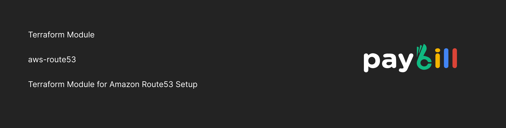

<p align="center">
  <a href="https://paybill.dev" target="_blank">
    <picture>
      
    </picture>
  </a>
</p>

### Route53 Hosted Zone & ACM Certificate Terraform Module

This Terraform module provisions a **Route 53 public hosted zone** and a **DNS-validated ACM certificate** for a given domain, including a wildcard certificate for all subdomains.

It automates the full certificate lifecycle by:

* Creating the hosted zone for the root domain
* Requesting an ACM certificate for the root domain and `*.domain`
* Automatically generating and managing DNS validation records in Route 53
* Completing ACM certificate validation without manual intervention

The module is designed to be **simple, opinionated, and safe for production use**, making it ideal for workloads such as:

* Application Load Balancers (ALB)
* CloudFront distributions
* API Gateway custom domains
* EKS ingress controllers
* SaaS platforms requiring wildcard TLS certificates

---

### Key Features

* **Public Route 53 hosted zone creation**
* **ACM certificate with DNS validation**
* **Wildcard TLS support (`*.domain`)**
* **Automatic DNS validation record management**
* **Zero manual steps after `terraform apply`**
* **Outputs ready for downstream modules (ALB, CloudFront, EKS, etc.)**

---

### Terraform Variables Example

```hcl
domain_name  = "example.com"
```

<!-- BEGIN_TF_DOCS -->
## Requirements

No requirements.

## Providers

| Name | Version |
|------|---------|
| <a name="provider_aws"></a> [aws](#provider\_aws) | n/a |

## Modules

No modules.

## Resources

| Name | Type |
|------|------|
| [aws_acm_certificate.cert](https://registry.terraform.io/providers/hashicorp/aws/latest/docs/resources/acm_certificate) | resource |
| [aws_acm_certificate_validation.cert_validation](https://registry.terraform.io/providers/hashicorp/aws/latest/docs/resources/acm_certificate_validation) | resource |
| [aws_route53_record.cert_validation](https://registry.terraform.io/providers/hashicorp/aws/latest/docs/resources/route53_record) | resource |
| [aws_route53_zone.main](https://registry.terraform.io/providers/hashicorp/aws/latest/docs/resources/route53_zone) | resource |

## Inputs

| Name | Description | Type | Default | Required |
|------|-------------|------|---------|:--------:|
| <a name="input_comment"></a> [comment](#input\_comment) | Comment for the hosted zone | `string` | `"Managed by Terraform"` | no |
| <a name="input_domain_name"></a> [domain\_name](#input\_domain\_name) | The domain name for the Route 53 hosted zone | `string` | n/a | yes |
| <a name="input_region"></a> [region](#input\_region) | AWS region to deploy resources | `string` | `"us-east-1"` | no |

## Outputs

| Name | Description |
|------|-------------|
| <a name="output_certificate_arn"></a> [certificate\_arn](#output\_certificate\_arn) | ARN of the issued ACM certificate |
| <a name="output_name_servers"></a> [name\_servers](#output\_name\_servers) | Name servers for the hosted zone |
| <a name="output_zone_id"></a> [zone\_id](#output\_zone\_id) | The ID of the Route 53 hosted zone |
<!-- END_TF_DOCS -->